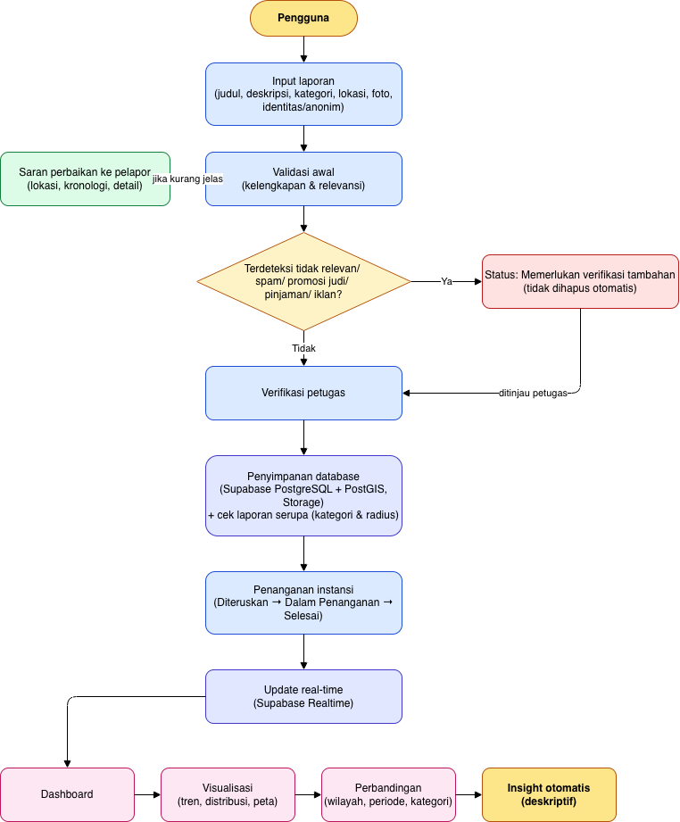
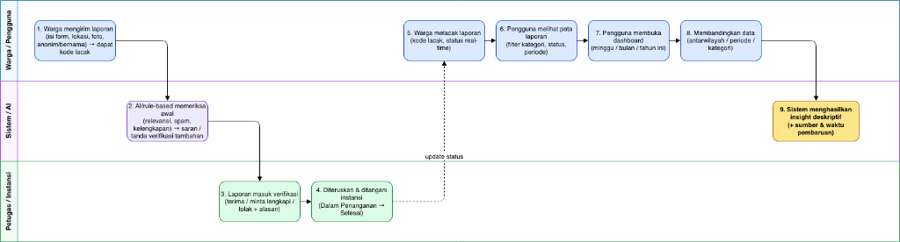
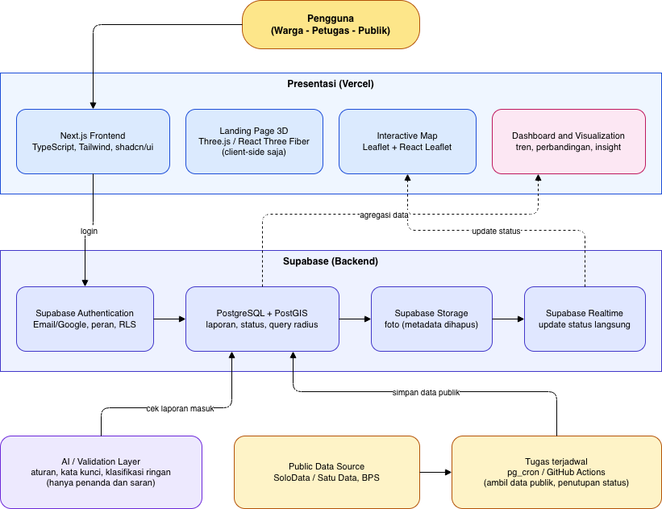

# RAMPUNG (Ruang Aduan, Monitor Penanganan, Ungkap Nyata Guyub)

Karya Kompetisi Web In Action (WIA) - Multimedia In Action (MIA) 2026  
Tim: OTW jdi nasabah prioritas (Institut Teknologi Sepuluh Nopember)
- Revalina Erica Permatasari (Project Manager & UI/UX Designer)
- Syifa Nurul Alfiah (Frontend Engineer)
- Putri Joselina Silitonga (Backend Engineer)

---

## 1. Deskripsi Project

RAMPUNG adalah platform web pelaporan keluhan warga dan analisis data publik berbasis transparansi dua arah, yang mengintegrasikan verifikasi bukti foto sebelum-sesudah (*before-after*) dengan dasbor wawasan kewargaan (*civic insight*) untuk mendukung akuntabilitas layanan publik Kota Surakarta. Melalui integrasi pelaporan partisipatif dan pemetaan geospasial, platform ini memastikan setiap aduan tertangani secara nyata dan hasilnya dapat diverifikasi langsung oleh masyarakat.

### Diagram Alur dan Arsitektur Sistem

#### Flowchart Sistem


#### User Flow


#### Arsitektur Sistem


---

## 2. Tech Stack yang Digunakan

| Komponen | Teknologi | Keterangan |
| :--- | :--- | :--- |
| Framework Utama | Next.js 14 (App Router) | Server-side rendering dan routing aplikasi terpadu |
| Bahasa Pemrograman | TypeScript | Keamanan tipe data statis (type safety) |
| Desain & Styling | Tailwind CSS | Utility-first CSS framework |
| Komponen Antarmuka | shadcn/ui (Radix UI) | Komponen aksesibel berstandar WCAG |
| Visualisasi 3D | Three.js / React Three Fiber | Elemen visual 3D interaktif pada beranda (client-side) |
| Peta Interaktif | Leaflet & React-Leaflet | Pemetaan titik sebaran laporan geospasial |
| Backend & Basis Data | Supabase (PostgreSQL) | Basis data relasional dan otentikasi (Row Level Security) |
| Ekstensi Geospasial | PostGIS | Kueri jarak radius untuk deteksi laporan serupa di sekitar lokasi |
| Penyimpanan Media | Supabase Storage | Penyimpanan foto kondisi sebelum dan sesudah (sanitasi metadata EXIF) |
| Pembaruan Real-Time | Supabase Realtime | Distribusi pembaruan status tiket penanganan secara langsung |
| Validasi Konten | Rule-Based Text Sanitizer | Deteksi dini spam, promosi, dan konten tidak relevan |
| Deployment & Hosting | Vercel | Platform hosting frontend teroptimasi |

---

## 3. Cara Menjalankan Project

### Prasyarat
- Node.js versi 18.17.0 atau lebih baru
- Package manager (npm, pnpm, atau yarn)
- Git

### Langkah Instalasi dan Menjalankan

1. **Clone Repository**
   ```bash
   git clone https://github.com/revaerica/WIA-OTW-jdi-nasabah-prioritas.git
   cd WIA-OTW-jdi-nasabah-prioritas
   ```

2. **Install Dependencies**
   ```bash
   npm install
   ```

3. **Konfigurasi Environment Variables**
   Salin berkas template lingkungan ke `.env.local`:
   ```bash
   cp .env.example .env.local
   ```
   Isi konfigurasi Supabase pada berkas `.env.local`:
   ```env
   NEXT_PUBLIC_APP_URL=http://localhost:3000

   # Supabase Configuration
   NEXT_PUBLIC_SUPABASE_URL=https://your-project.supabase.co
   NEXT_PUBLIC_SUPABASE_ANON_KEY=your-anon-key-here
   SUPABASE_SERVICE_ROLE_KEY=your-service-role-key-here
   ```

4. **Setup Database (Supabase SQL Editor)**
   Jalankan query DDL berikut pada SQL Editor Supabase untuk mengaktifkan ekstensi PostGIS dan tabel master:
   ```sql
   -- Mengaktifkan ekstensi geospasial PostGIS
   CREATE EXTENSION IF NOT EXISTS postgis;

   -- Tabel master laporan warga
   CREATE TABLE IF NOT EXISTS laporan_warga (
       id UUID PRIMARY KEY DEFAULT gen_random_uuid(),
       kode_lacak VARCHAR(12) UNIQUE NOT NULL,
       judul VARCHAR(200) NOT NULL,
       deskripsi TEXT NOT NULL,
       kategori VARCHAR(50) NOT NULL,
       lokasi_deskripsi TEXT,
       koordinat GEOMETRY(Point, 4326) NOT NULL,
       foto_sebelum_url TEXT NOT NULL,
       foto_sesudah_url TEXT,
       is_anonim BOOLEAN DEFAULT FALSE,
       nama_pelapor VARCHAR(100),
       status VARCHAR(30) DEFAULT 'Baru',
       created_at TIMESTAMPTZ DEFAULT NOW()
   );

   -- Indeks spasial untuk kueri radius laporan terdekat
   CREATE INDEX IF NOT EXISTS idx_laporan_koordinat ON laporan_warga USING GIST (koordinat);
   ```

5. **Menjalankan Server Pengembangan**
   ```bash
   npm run dev
   ```
   Buka peramban pada alamat `http://localhost:3000`.

6. **Build Produksi**
   ```bash
   npm run build
   npm run start
   ```

---

## 4. Progress Saat Ini

Pada tahap **First Draft Submission (01 November 2026)**, progres tim saat ini berfokus pada **tahap pembuatan UI/UX, arsitektur informasi, wireframing, dan interactive prototype di Figma**, sembari menyiapkan fondasi arsitektur kode dan basis data:

| Modul / Komponen | Rincian Pekerjaan | Status Saat Ini |
| :--- | :--- | :--- |
| Perancangan UI/UX (Figma) | Perancangan alur interaksi, wireframe layar utama, design system, dan prototype interaktif di Figma. | Sedang Berjalan (Fokus Utama) |
| Perancangan Sistem & Data | Penyusunan flowchart alur sistem, user flow swimlane, arsitektur sistem, dan skema PostGIS. | Selesai |
| Inisialisasi Repositori | Setup proyek Next.js 14 App Router, konfigurasi TypeScript, Tailwind CSS, dan dokumentasi teknis. | Sedang Berjalan |
| Implementasi Antarmuka Web | Penyiapan kerangka halaman (landing page, form pelaporan cepat, modul pelacakan resi, peta Leaflet). | Tahap Awal |
| Integrasi Backend & API | Konfigurasi instance Supabase, bucket penyimpanan foto, dan integrasi API geospasial. | Direncanakan (Tahap Final) |
